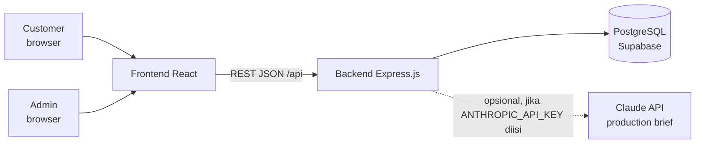
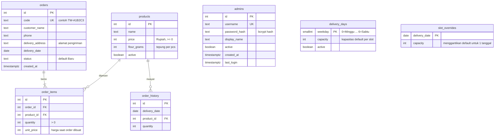
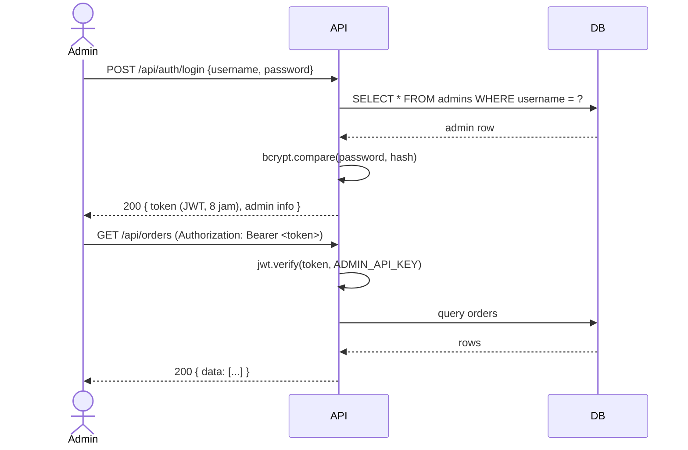
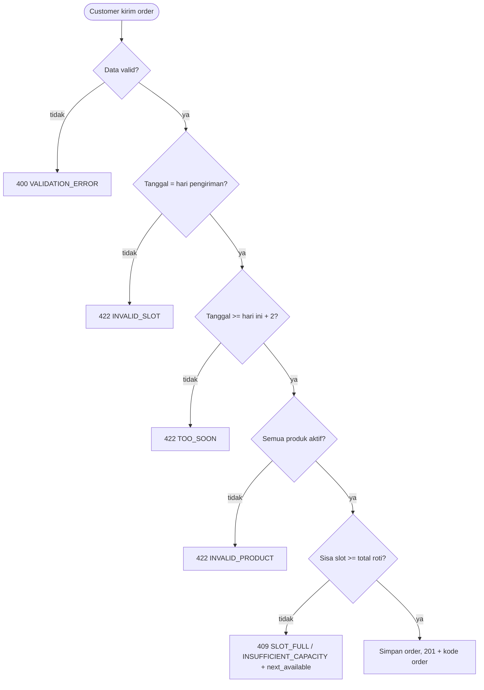
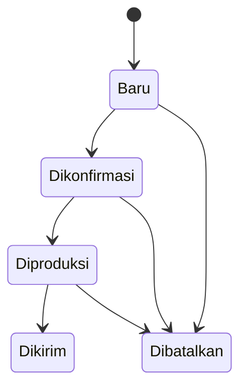

# Arsitektur Sistem, Skema Database, dan Capacity Management

## 1. Gambaran Sistem



Backend memakai pola **route → service → database**:

| Lapisan | Folder | Tugas |
|---|---|---|
| Route | `src/routes/` | Menerima request HTTP, memeriksa hak akses (publik/admin), memanggil service. |
| Service | `src/services/` | Aturan bisnis: `slotService`, `orderService`, `predictionService`, `briefService`, `adminService`, `paymentService`. |
| Middleware | `src/middleware/` | Autentikasi admin (JWT + API key), rate limit, header keamanan, penanganan error. |
| Database | `src/db.js`, `src/migrate.js`, `migrations/` | Koneksi PostgreSQL (pool), transaksi, dan skema (file migrasi SQL). |

Tanggal pengiriman bertipe `DATE` di PostgreSQL dan selalu dibaca aplikasi sebagai teks `YYYY-MM-DD` (zona waktu Asia/Jakarta),
bukan objek `Date`, supaya tidak bergeser karena zona waktu.

**Hak akses:**
- **Publik** — lihat produk, lihat slot, buat order, lacak order dengan kode
- **Admin** — semua endpoint publik + kelola order, produksi, produk, slot, dan manajemen akun admin

Admin autentikasi lewat JWT token dari `POST /api/auth/login`, atau header `x-admin-key` (backward-compatible).

## 2. Skema Database



Catatan desain:

- **Skema dibuat lewat migrasi** (`migrations/001_init.sql` dst.), dijalankan oleh `npm run migrate` atau otomatis saat server start.
  Perubahan berikutnya = file baru (`002_...sql`), bukan mengedit file lama.
- Kolom `status` dibatasi constraint `CHECK` (Baru, Dikonfirmasi, Diproduksi, Dikirim, Dibatalkan).
- **Slot tidak disimpan sebagai tabel.** Slot dihitung dari `delivery_days` dan `slot_overrides`, lalu dikurangi jumlah order aktif.
- `order_items.unit_price` menyimpan harga **saat order dibuat** — mengubah harga produk tidak mengubah order lama.
- `order_history` berisi data historis untuk melatih model prediksi. Order nyata yang terkonfirmasi juga dicatat ke sini.
- `ON DELETE CASCADE` hanya pada `order_items`. Produk yang sudah dipakai tidak bisa dihapus (409); nonaktifkan dengan `active: false`.
- Tabel `admins` menyimpan password sebagai **bcrypt hash** (12 rounds). Password asli tidak bisa dibaca balik dari database.
- Semua tabel mengaktifkan **Row Level Security (RLS)** karena database di-host di Supabase.

## 3. Autentikasi Admin



JWT ditandatangani dengan `ADMIN_API_KEY` dari `.env`. Token berlaku **8 jam**.
Salah memasukkan kredensial 10 kali = IP diblokir 15 menit (rate limit).

## 4. Mekanisme Capacity Management

**Rumus** (`src/services/slotService.js`):

```
kapasitas = slot_overrides[tanggal] jika ada, kalau tidak delivery_days[hari].capacity
terisi    = jumlah quantity semua order pada tanggal itu yang statusnya BUKAN Dibatalkan
sisa      = max(0, kapasitas - terisi)
status    = "available" jika sisa > 0, selain itu "full"
```

Kapasitas dihitung per **jumlah roti**, bukan per jumlah order.

**Alur membuat order** (`POST /api/orders`), semuanya dalam satu transaksi database:



- **Order bersamaan aman** — pengecekan dan penyimpanan dalam satu transaksi dengan advisory lock per tanggal.
- **Pesanan minimal H+2** karena produksi dilakukan H-2 (`MIN_LEAD_DAYS`).
- **Membatalkan order** langsung mengembalikan kapasitas.
- **Bulk order / libur** — admin ubah kapasitas satu tanggal lewat `PUT /api/slots/:date/capacity`.

## 5. Status Order



| Status | Memakai kapasitas slot | Masuk target production brief |
|---|---|---|
| Baru | ya | tidak (dilaporkan sebagai "belum dikonfirmasi") |
| Dikonfirmasi, Diproduksi, Dikirim | ya | ya |
| Dibatalkan | tidak | tidak |
