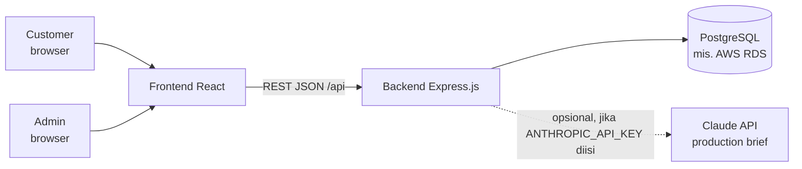
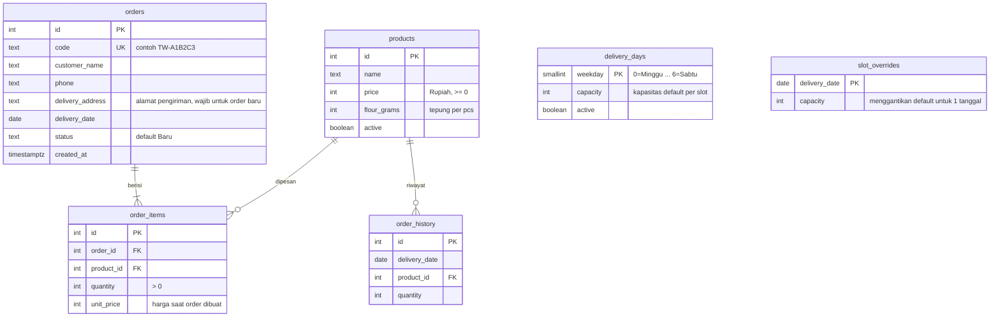
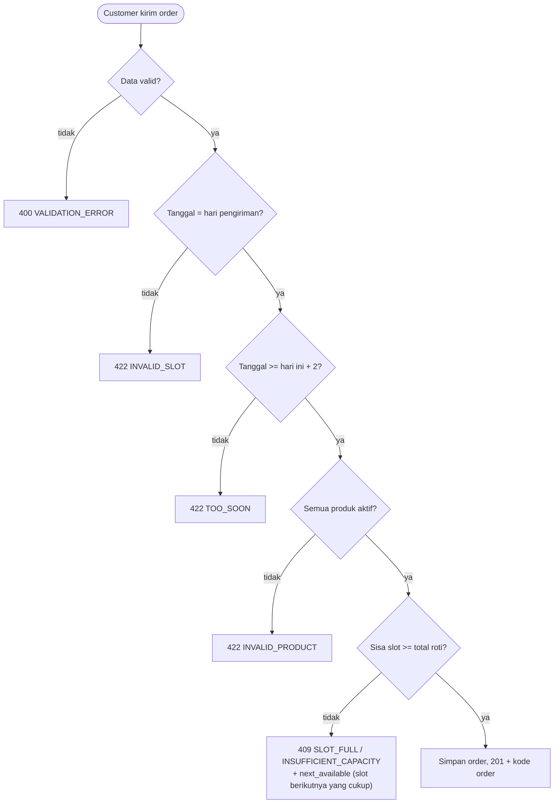
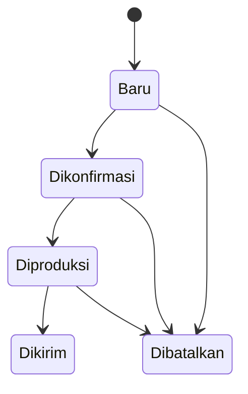

# Arsitektur Sistem, Skema Database, dan Capacity Management

## 1. Gambaran sistem



Backend memakai pola **route → service → database**:

| Lapisan | Folder | Tugas |
|---|---|---|
| Route | `src/routes/` | Menerima request HTTP, memeriksa hak akses (publik/admin), memanggil service. |
| Service | `src/services/` | Aturan bisnis: `slotService` (kapasitas), `orderService` (order dan status), `predictionService` (model demand), `briefService` (production brief). |
| Middleware | `src/middleware/` | Autentikasi admin, rate limit, header keamanan, penanganan error. |
| Database | `src/db.js`, `src/migrate.js`, `migrations/` | Koneksi PostgreSQL (pool), transaksi, dan skema (file migrasi SQL). |

Tanggal pengiriman bertipe `DATE` di PostgreSQL dan selalu dibaca aplikasi sebagai teks `YYYY-MM-DD` (zona waktu Asia/Jakarta), bukan objek `Date`, supaya tidak bergeser karena zona waktu.

Hak akses: endpoint **publik** (lihat produk, lihat slot, buat order, cek order dengan kode) dan endpoint **admin** (header `x-admin-key`). Daftar lengkap ada di `README.md`.

## 2. Skema database



Catatan desain:

- **Skema dibuat lewat migrasi** (`migrations/001_init.sql`, dijalankan oleh `npm run migrate` atau otomatis saat server start dan dicatat di tabel `schema_migrations`). Perubahan berikutnya = file baru (`002_...sql`), bukan mengedit file lama.
- Kolom `status` dibatasi constraint `CHECK` (Baru, Dikonfirmasi, Diproduksi, Dikirim, Dibatalkan), dan kapasitas, harga, serta jumlah tidak boleh negatif di level database.
- **Slot tidak disimpan sebagai tabel.** Slot dihitung dari `delivery_days` (hari rutin, misalnya Selasa dan Jumat) dan `slot_overrides` (kapasitas khusus satu tanggal), lalu dikurangi jumlah order aktif. Jadi tidak ada data slot yang bisa tidak sinkron dengan order.
- `order_items.unit_price` menyimpan harga **saat order dibuat**, jadi mengubah harga produk tidak mengubah order lama.
- `order_history` berisi data historis (sintetis atau impor) untuk melatih model. Order nyata yang tanggalnya sudah lewat ikut dipakai model, tanpa perlu disalin ke tabel ini.
- `ON DELETE CASCADE` hanya pada `order_items`. Produk yang sudah dipakai di order atau histori tidak bisa dihapus (409); nonaktifkan dengan `active: false`.

## 3. Mekanisme capacity management

**Rumus** (`src/services/slotService.js`):

```
kapasitas = slot_overrides[tanggal] jika ada, kalau tidak delivery_days[hari].capacity
terisi    = jumlah quantity semua order pada tanggal itu yang statusnya BUKAN Dibatalkan
sisa      = max(0, kapasitas - terisi)
status    = "available" jika sisa > 0, selain itu "full"
```

Kapasitas dihitung per **jumlah roti**, bukan per jumlah order. Order berstatus `Baru` sudah memakai kapasitas supaya slot tidak terjual berlebih sebelum admin sempat mengonfirmasi.

**Alur membuat order** (`POST /api/orders`), semuanya dalam satu transaksi database:



- **Slot penuh otomatis tidak bisa dipilih.** `GET /api/slots` mengembalikan `status: "full"` beserta `next_available` (misalnya Jumat). Frontend menonaktifkan pilihan itu dan menawarkan slot alternatifnya. Jika ada yang tetap mengirim, backend menolak dengan 409.
- **Order bersamaan aman.** Pengecekan sisa dan penyimpanan terjadi dalam satu transaksi, dan setiap transaksi pertama-tama mengambil *advisory lock* PostgreSQL (`pg_advisory_xact_lock`) untuk tanggal pengiriman yang sama. Transaksi lain untuk tanggal itu menunggu sampai selesai, lalu membaca sisa kapasitas yang sudah diperbarui. Jadi dua customer yang memesan hampir bersamaan tidak bisa sama-sama melewati kapasitas, bahkan jika ada beberapa instance aplikasi. Tanggal yang berbeda tidak saling menunggu. Kunci yang sama dipakai saat mengaktifkan kembali order dibatalkan dan saat admin mengubah kapasitas.
- **Pesanan minimal H+2** karena produksi dilakukan H-2 (`MIN_LEAD_DAYS`).
- **Membatalkan order** (`Dibatalkan`) langsung mengembalikan kapasitas.
- **Mengaktifkan kembali order yang dibatalkan** dicek ulang terhadap sisa kapasitas. Jika tidak cukup: 409 `INSUFFICIENT_CAPACITY` dan order tetap `Dibatalkan`.
- **Bulk order / libur:** admin mengubah kapasitas satu tanggal (`PUT /api/slots/:date/capacity`). Kapasitas tidak boleh di bawah jumlah order aktif (422). Nilai 0 menutup slot itu.

## 4. Status order



Ini alur yang dianjurkan. API sendiri **tidak memaksa urutan** status (admin bisa memilih status mana pun); satu-satunya pemeriksaan adalah kapasitas saat order dibatalkan diaktifkan lagi.

| Status | Memakai kapasitas slot | Masuk target production brief |
|---|---|---|
| Baru | ya | tidak (dilaporkan sebagai "belum dikonfirmasi") |
| Dikonfirmasi, Diproduksi, Dikirim | ya | ya |
| Dibatalkan | tidak | tidak |
